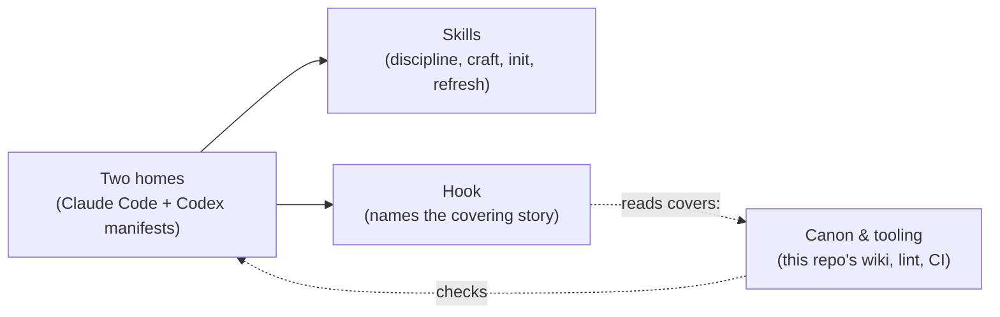

# Architecture — the `stories` plugin

This repo is a **plugin** that keeps a wiki of *why* a codebase is the way it is, inside any project it's installed into. There is no application code: the product is a few rule-files ("skills") and one small hook, shipped from a single copy into two AI coding tools, Claude Code and Codex. A health-check script keeps this repo's own wiki honest.

| block | in plain words | why it is this way |
|---|---|---|
| Skills | The rules the model follows: when to read and rewrite stories (`skills/stories/SKILL.md`), how to write them (`writing.md`), and the two procedures, init and refresh. Prose only — no code. | [the-gate](docs/stories/sagas/the-gate.md), [the-craft](docs/stories/sagas/the-craft.md) |
| Hook | `hooks/stories.py` tells the model which story covers a file it reads or edits, holds back an unannounced edit once, and reminds once at the end of a turn. It reads the wiki; it never writes it. | [the-gate](docs/stories/sagas/the-gate.md) |
| Two homes | The Claude Code and Codex manifests. Everything else under `codex/` is a symlink to the root. | [codex-port](docs/stories/sagas/codex-port.md) |
| Canon & tooling | This repo's own `docs/stories/`, the linter (`scripts/lint-canon.py`), and the CI that runs it. Dev-only — it ships to no one. | [the-lint](docs/stories/sagas/the-lint.md), [the-map](docs/stories/sagas/the-map.md) |

## Invariants

- The hook never edits a file, and an error inside it never blocks work.
- `codex/` holds no copy of anything except its manifest.
- The rules live only in `skills/stories/SKILL.md`; every other document points there.
- No user ever receives the linter.

---

Deeper: `docs/stories/index.md` (the Atlas).

<!-- derived by the stories plugin — source of truth: the code and docs/stories/ -->
