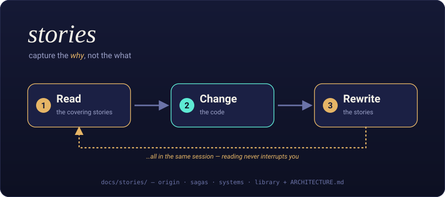

# stories

[](https://github.com/suncloudsmoon/stories/actions/workflows/lint.yml)
[](LICENSE)



A Claude Code plugin that maintains a **soul-bearing wiki** of your codebase under `docs/stories/`.

Most docs describe *what* the code does. Stories capture the *why* — the tension a decision resolved, the road not taken, what the maker cares about. The model reads the relevant stories before any non-trivial change and rewrites them after, so the canon stays true as the code moves. The same wiki doubles as a general knowledge base for deep-research results, syntheses, and sources — one interlinked graph where research links to the code it shaped.

It's a storytelling take on the LLM-wiki pattern: the same LLM-maintained, compounding knowledge base, repointed from "a knowledge base of sources" to "the soul of a codebase."

## Install (Claude Code)

```bash
claude plugin marketplace add suncloudsmoon/plugins   # registers marketplace "suncloudsmoon"
claude plugin install stories@suncloudsmoon

# or from a local clone, before it's published:
#   claude plugin marketplace add /path/to/stories
```

Restart Claude Code to load it. The plugin stays **dormant** until a repo has `docs/stories/` — run `/stories:stories-init` there to start one.

## How it works

- **A hook points; the model reads.** When the model reads or edits a file a story covers, the plugin's hook names that story — once per session. An edit that arrives before its story was named is held back once, so the story is always read first. At the end of a turn, if covered code changed and its story didn't, the hook asks once whether the why changed.
- **The model keeps the canon true.** After a change it rewrites the stories whose why shifted, updates `ARCHITECTURE.md` when the shape moved, and keeps the Atlas current — in the same session.
- **Low friction.** It stops to ask only when your request contradicts a story.
- **Anchors, not line numbers.** Stories cite code as `path#anchor` — a name that appears in the file — so citations survive edits and break only when the thing they name does.
- **Knowledge, too.** Deep-research results and sources you hand it land in `library/`, linked to the code they shaped.

The exact rules live in one place: [`skills/stories/SKILL.md`](skills/stories/SKILL.md).

## Layout

```
ARCHITECTURE.md     # the shape — summary, diagram, block table, invariants
docs/stories/
  index.md          # the Atlas — one line per page
  origin.md         # why the project exists, your preferences as lore
  sagas/            # stories about code — each has covers: globs
  library/          # research, sources, concepts
```

## Skills

- `/stories:stories-init` — start a wiki: interview you, write the origin story and `ARCHITECTURE.md`.
- `/stories:stories-refresh` — reconcile stale stories with the code, prune dead pages, rebuild the Atlas and the map.

The hook needs `python3` on your `PATH`. Without it the skill still works; the model finds covering stories itself.

## Coexistence

`stories` lives in its own namespace and its own `docs/` subdir. It works **with or without** superpowers and never replaces it.

## Codex

`codex/` is the same plugin for Codex: every skill and the hooks are symlinks to the root, so only the manifest is separate. Invoke the skills as `$stories-init` and `$stories-refresh`; Codex asks once to trust the plugin's hooks. Install: [`codex/README.md`](codex/README.md).

## Design

[`docs/specs/2026-10-29-stories-2-simplify-design.md`](docs/specs/2026-10-29-stories-2-simplify-design.md) — the 2.0 design and the evidence behind it.

## License

MIT — see [`LICENSE`](LICENSE). Copyright © 2026 suncloudsmoon.
